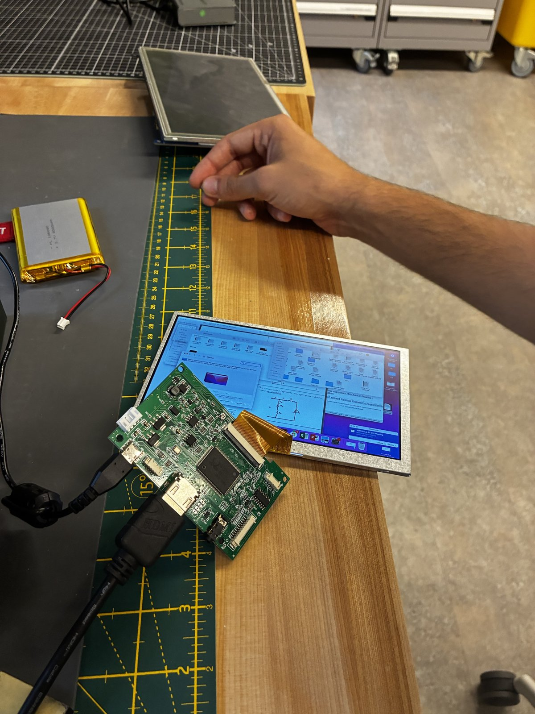
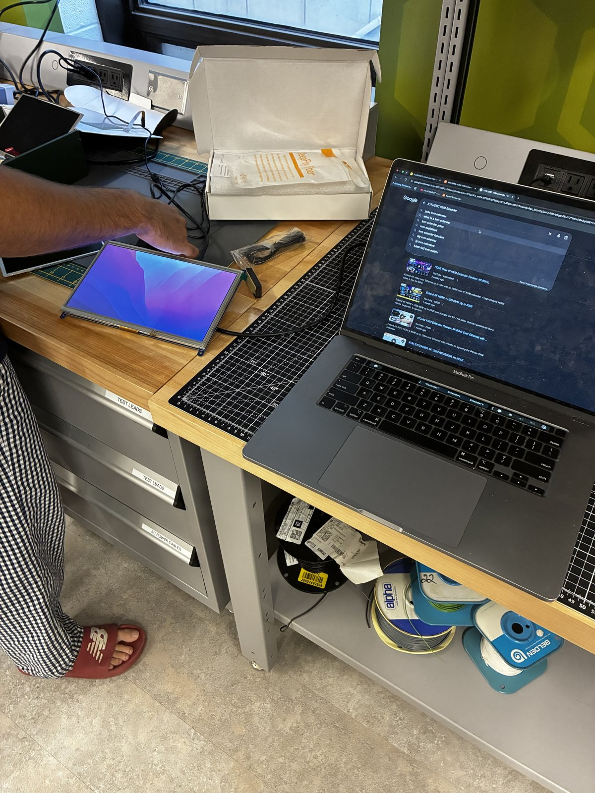
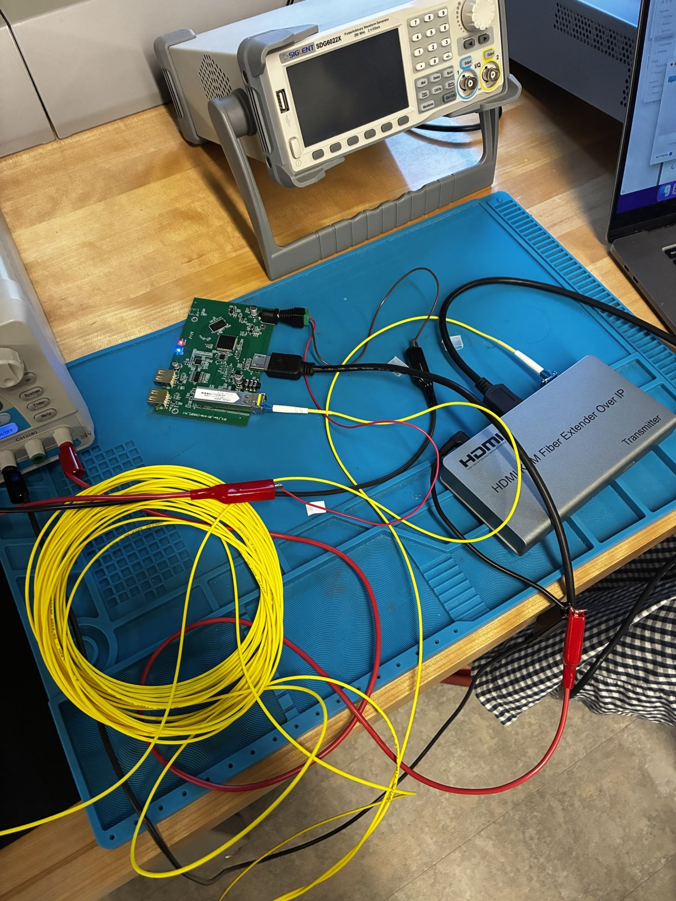
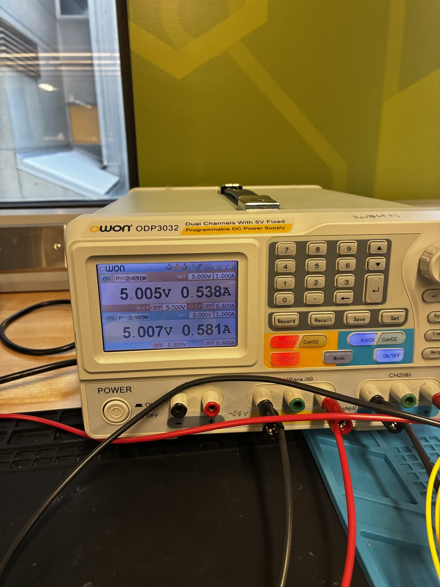
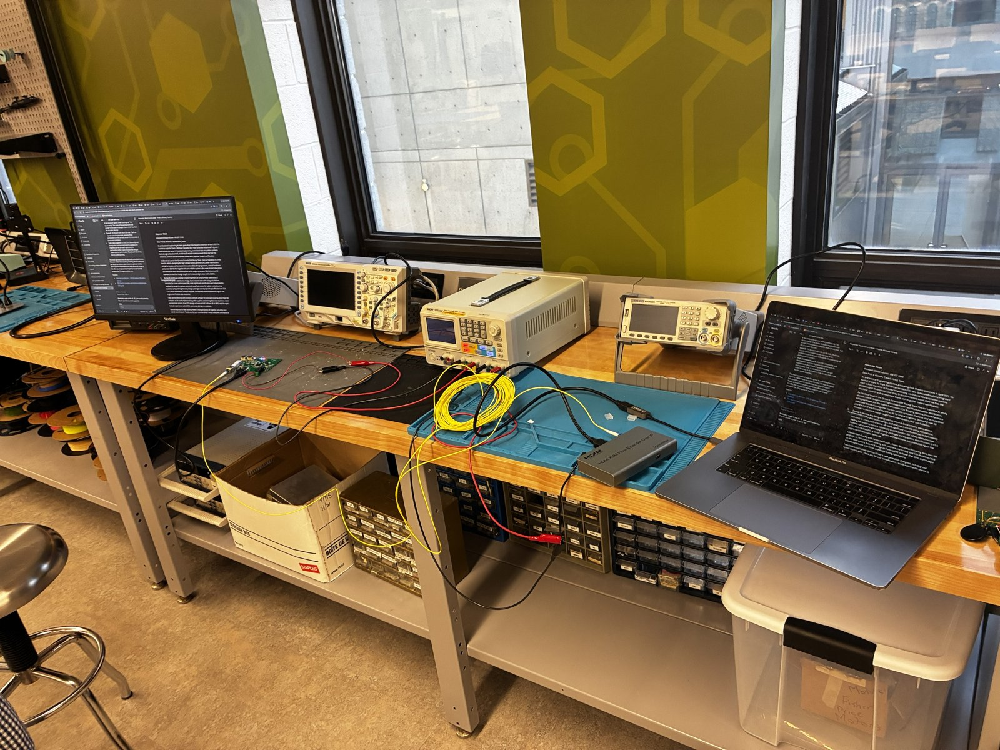

# Capstone – Bench Testing Log

**Course:** ELEC 490/498 Electrical Engineering Project (Group 25)

This log records hardware bring-up and testing done on the capstone project.

---

## Session: November 1, 2026

**Date:** 2026-11-01

### 1. Display bring-up

- Powered up both the **old (small) display** and the **new, larger display**.
- **Result:** Both displays work.
- The new display is driven by an HDMI driver board with a ribbon cable to the panel. It showed the laptop's desktop over HDMI.

### 2. Fiber optic link

- Established communication over fiber optic using hardware left over from the previous team.

| Role | Hardware |
|------|----------|
| Transmitter | HDMI/KVM fiber extender over IP |
| Receiver | Green PCB with an SFP fiber module |
| Link | Yellow single-strand fiber patch cables |

- **Result:** The link was established and carried **video**.

### 3. Power

- A bench DC power supply (OWON ODP3032, dual channel) powered both the transmitter and the receiver, one on each channel.

| Channel | Set | Measured voltage | Measured current | Power |
|---------|-----|------------------|------------------|-------|
| CH1 | 5.000 V / 1.000 A | 5.005 V | 0.538 A | 2.691 W |
| CH2 | 5.000 V / 1.000 A | 5.007 V | 0.581 A | 2.909 W |

### Full test setup

---

## Session: November 2, 2026

**Date:** 2026-11-02

### Low-voltage test: MRI-side fiber optic receiver

Lowered the supply voltage to the fiber optic receiver to find the minimum input voltage at which it still works.

| Vin (V) | Current (A) | Power (W) | Working? |
|---------|-------------|-----------|----------|
| 4.75 | 0.55 | 2.61 | Yes |
| 4.5 | 0.56 | 2.52 | Yes |
| 4.3 | 0.58 | 2.49 | Yes |
| 4.1 | 0.59 | 2.42 | Yes |
| 3.9 | 0.60 | 2.34 | Yes |
| 3.8 | n/a | n/a | No |
| 3.7 | n/a | n/a | No |

**Result:** The receiver works down to **3.9 V** and stops working at 3.8 V. Current rises slightly as voltage drops (0.55 A to 0.60 A), while power drops slightly (about 2.6 W to 2.3 W). Power is calculated as Vin × current.

---

## Next steps

Focus: **power**. Everything on the bench is currently running from a DC power supply, and that needs to change.

- [ ] **Move to battery power.** Replace the bench power supply so the system runs without it.
- [ ] **Identify which parts need replacement.** Review the existing hardware (displays, driver board, fiber transmitter and receiver) and decide what has to be swapped out with non ferro-magnetic alternatives.
- [ ] **Find replacement parts.** Source the parts identified above.
- [ ] **Disassemble Screen** Ask Dr.Pan for help with this.

### Fiber optic receiver: magnetic parts to replace

Parts on the receiver board that are magnetic and need to be replaced for MRI compatibility:

| Part | Action |
|------|--------|
| Optical receiver (SFP module) | Replace with a non-magnetic equivalent |
| HDMI shroud | Replace with a non-magnetic equivalent |
| USB shrouds | Desolder and remove. USB is not needed for this project. |
| 5V DC connector | Desolder and hardwire the power leads directly to the board. |

- [ ] Find a non-magnetic optical receiver
- [ ] Find a non-magnetic HDMI connector/shroud
- [ ] Desolder the USB connectors
- [ ] Desolder the 5V DC connector and hardwire power in

### Candidate parts

| Part | Link | Price | Notes |
|------|------|-------|-------|
| Resistive Touch Screen to USB Mouse Controller - AR1100 (Adafruit #1580) | [adafruit.com/product/1580](https://www.adafruit.com/product/1580) | $9.95 (1-9 units) | Converts a 4-wire resistive touchscreen to a USB mouse/digitizer, no drivers needed. USB (Type-C) and UART (TTL) interfaces. 1 mm FPC connector for the touchscreen. 29.2 x 20.3 x 4.9 mm, 2.8 g. Calibration software is Windows-only. 39 in stock on 2026-11-13. |

- [ ] Check whether the AR1100 board and its USB Type-C connector are non-magnetic (Adafruit's page does not list materials)
